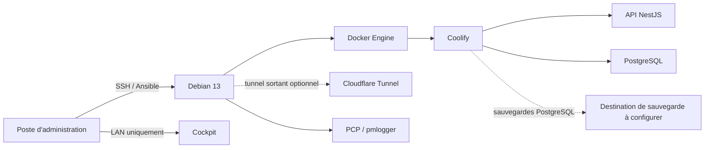

<div align="center">
  
  <br>
  <a href="https://github.com/alexandrebouttierdev/homelab-ansible/actions/workflows/ansible-checks.yml">
    
  </a>
  
  
  
  <br><br>
  <strong>Provisionner un serveur domestique sans transformer son administration en usine à gaz.</strong>
  <br>
  Debian · sécurité · Docker Engine · supervision · Cloudflare Tunnel
  <br><br>
  <a href="#-démarrage-rapide">Démarrage rapide</a> ·
  <a href="#-architecture">Architecture</a> ·
  <a href="#-sécurité">Sécurité</a> ·
  <a href="#-documentation">Documentation</a>
</div>

---

## À propos

`homelab-ansible` automatise la configuration système d’un homelab sous
**Debian 13 (Trixie)**. Le projet vise une infrastructure simple à comprendre,
reproductible et adaptée aux ressources limitées d’un serveur personnel.

Ansible prépare l’hôte ; **Coolify garde la responsabilité des applications**,
de PostgreSQL et de leurs sauvegardes. Les déploiements ne touchent pas aux
données applicatives.

> **Déploiement manuel uniquement.** GitHub Actions contrôle le dépôt, mais ne
> se connecte jamais au serveur et ne déclenche aucun changement en production.

## ✨ Ce que le projet configure

| Domaine | Composants |
| --- | --- |
| Socle système | Debian, paquets de base, fuseau horaire, Chrony, journald, mises à jour de sécurité |
| Accès et sécurité | compte administrateur, SSH, AppArmor, UFW, Fail2ban, paramètres noyau |
| Conteneurs | Docker Engine, Compose, Buildx, rotation des logs, règles réseau |
| Supervision | Cockpit, PCP et pmlogger |
| Optionnels | Beszel Agent et Cloudflare Tunnel, activés explicitement |

## 🏗️ Architecture



### Frontières de responsabilité

- **Ansible** : Debian, SSH, firewall, Docker Engine, Cockpit/PCP et agents natifs.
- **Coolify** : déploiements applicatifs, conteneurs gérés par Coolify, PostgreSQL,
  API NestJS et sauvegardes PostgreSQL.
- **Hors périmètre** : configuration de la box/routeur, VLAN/switch, partitionnement
  du HDD et déploiement des applications.

> **Réseau Docker :** les ports publiés par Docker peuvent contourner les règles
> UFW habituelles. Inspecter les ports et les chaînes effectives avant toute
> exposition. Ne pas publier PostgreSQL ou Redis sur Internet.

## 🚀 Démarrage rapide

### 1. Prérequis

**Sur le serveur Debian**

- Debian 13 installé, avec les comptes `root` et `alex` ;
- SSH actif et clé publique du poste de contrôle autorisée pour `alex` ;
- accès réseau stable et adresse IP connue ;
- mot de passe root défini pour le bootstrap initial.

**Sur le poste de contrôle**

- Python 3 et Ansible Core ;
- accès SSH par clé à `alex` ;
- collections Ansible requises par [`requirements.yml`](requirements.yml).

### 2. Préparer Ansible (Fedora)

```bash
sudo dnf install python3 python3-pip
python3 -m venv ~/.venvs/homelab-ansible
source ~/.venvs/homelab-ansible/bin/activate
python -m pip install ansible-core ansible-lint yamllint

cd /chemin/vers/homelab-ansible
ansible-galaxy collection install -r requirements.yml
```

### 3. Préparer l’inventaire et la clé

Vérifier l’adresse, l’utilisateur et le chemin de clé dans
[`inventory/hosts.yml`](inventory/hosts.yml). Les valeurs du dépôt sont des
exemples propres à l’environnement ; adaptez-les à la machine ciblée.

La clé publique locale est lue depuis
`~/.ssh/homelab_ed25519.pub`. Pour créer la paire et installer la clé :

```bash
ssh-keygen -t ed25519 -a 64 -f ~/.ssh/homelab_ed25519
ssh-copy-id -i ~/.ssh/homelab_ed25519.pub alex@IP_SERVEUR
ssh -i ~/.ssh/homelab_ed25519 alex@IP_SERVEUR
```

### 4. Bootstrap initial automatisé

Sur une Debian fraîche, Ansible installe `sudo` et ajoute `alex` au groupe
administrateur. Le mot de passe root est demandé à l’exécution par Ansible
et n’est pas stocké dans le dépôt :

```bash
ansible-playbook playbooks/bootstrap.yml --ask-become-pass
```

Ouvrir ensuite **une nouvelle session SSH** pour prendre en compte le groupe
`sudo`. Il faudra connaître le mot de passe Linux d’`alex` pour les tâches
administratives.

> Ansible ne peut pas installer Debian, activer SSH ou créer le premier accès
> réseau : la cible doit déjà être joignable par SSH.

### 5. Préflight et déploiement

```bash
ansible homelab -m ping
ansible-playbook playbooks/preflight.yml --ask-become-pass

# Prévisualiser les changements
ansible-playbook playbooks/site.yml --check --diff --ask-become-pass

# Appliquer la configuration
ansible-playbook playbooks/site.yml --ask-become-pass

# Vérifier les services après déploiement
ansible-playbook playbooks/verify.yml --ask-become-pass
```

Conserver une session SSH de secours. Avant d’activer ou de changer le
durcissement SSH, tester l’authentification par clé dans une deuxième session.
Le mode `--check` ne remplace pas un test réel.

## 🔐 Secrets et configuration

Les paramètres non sensibles sont dans
[`inventory/group_vars/all/main.yml`](inventory/group_vars/all/main.yml).
Ne commitez jamais un token, mot de passe ou secret en clair.

```bash
cp inventory/group_vars/all/vault.yml.example \
  inventory/group_vars/all/vault.yml
ansible-vault encrypt inventory/group_vars/all/vault.yml
ansible-vault edit inventory/group_vars/all/vault.yml
```

Le fichier `vault.yml` est exclu de Git. Les variables sensibles sont masquées
par les tâches Ansible concernées. N’ajoutez pas de secrets réels au fichier
d’exemple.

| Variable / option | Valeur initiale | Rôle |
| --- | --- | --- |
| `ssh_hardening_enabled` | `true` | Durcissement SSH, protégé par des assertions |
| `ufw_enabled` | `true` | Pare-feu local |
| `fail2ban_enabled` | `true` | Protection des tentatives SSH |
| `docker_add_admin_user` | `false` | Évite d’accorder à `alex` l’accès root via Docker |
| `beszel_agent_enabled` | `false` | À activer après préparation du Hub et de la clé |
| `cloudflared_enabled` | `false` | À activer après ajout du token au Vault |

## 🧪 Vérifications automatiques

À chaque push ou pull request vers `dev` ou `main`, GitHub Actions lance les
contrôles statiques du dépôt :

- recherche de secrets évidents ;
- validation YAML et syntaxe des playbooks ;
- validation de l’inventaire ;
- `ansible-lint`.

L’action n’a que les permissions de lecture du dépôt. Elle ne contient pas de
secrets de déploiement et n’accède pas au réseau du homelab.

Pour lancer les mêmes contrôles localement :

```bash
./scripts/static-checks.sh
```

## 📚 Documentation

| Guide | Contenu |
| --- | --- |
| [Architecture](docs/ARCHITECTURE.md) | Composants, réseau et séparation Ansible/Coolify |
| [Sécurité](docs/SECURITY.md) | SSH, firewall, Docker, AppArmor, secrets |
| [Déploiement applicatif](docs/DEPLOIEMENT-APPLICATIONS.md) | Coolify, Beszel et Cloudflare |
| [Sauvegardes](docs/SAUVEGARDES.md) | Sauvegardes PostgreSQL et données Coolify |
| [Maintenance](docs/MAINTENANCE.md) | Mises à jour, commandes et idempotence |
| [Exploitation](docs/OPERATIONS.md) | Vérifications système et services |
| [Récupération](docs/RECOVERY.md) | SSH, firewall, Docker et incidents |
| [Gestion des vulnérabilités](docs/VULNERABILITY-MANAGEMENT.md) | Sources et procédure CVE |
| [Instructions pour les assistants IA](AGENTS.md) | Contexte et règles à respecter dans ce dépôt |

## 🤖 Assistants de développement

Les consignes communes sont dans [`AGENTS.md`](AGENTS.md). Les points d’entrée
pour Claude Code et Cursor sont dans [`CLAUDE.md`](CLAUDE.md) et
[`.cursor/rules/homelab-ansible.mdc`](.cursor/rules/homelab-ansible.mdc).

## ⚠️ Limites et précautions

- Ce dépôt **ne gère pas** les applications et sauvegardes PostgreSQL de Coolify.
- Il ne formate aucun disque et ne déplace aucune donnée persistante.
- UFW seul ne suffit pas pour conclure qu’un port Docker est filtré.
- Le groupe `docker` est pratiquement équivalent à root ; Beszel l’utilise
  uniquement si l’agent est activé, avec ce compromis.
- Toute exposition d’un service via Cloudflare doit être explicitement définie
  et protégée, par exemple avec Cloudflare Access pour une interface d’administration.
- Vérifier l’inventaire, les variables et l’état réel du serveur avant chaque
  exécution sur une machine de production.
